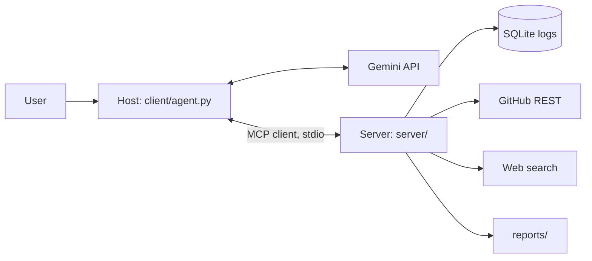

# Incident Detective — Build Plan (MVP)

This is the working plan for the one-day MVP. The long-form source brief is
`Incident Detective AI Agent Build Plan (one-day sprint).md`; this file records
what was actually built and the decisions taken along the way.

## Goal

Ship a working MCP server plus a user-written MCP client/host that turns a vague
production symptom into an evidence-backed diagnosis, demonstrated on a real
GitHub repository.

**Scope:** Phases 0–5 (scaffold through the end-to-end agent). Phases 6–9
(server mode, OAuth, packaging, stretch) are out of scope for the MVP.

## Architecture

- **Host** = `client/agent.py` (CLI + agent loop).
- **Client** = the SDK `Client` session inside the host.
- **Server** = `server/`, independent of the LLM; also works in the Inspector.

## Phases

| Phase | Deliverable | Status | Commit |
|---|---|---|---|
| 0 | Repo scaffold, venv, pinned requirements, hello tool, Inspector check | done | `7133d27` |
| 1 | Deterministic log DB (`data/seed.py` → `data/incidents.db`) | done | `fd1a255` |
| 2 | Planted demo incident in `test_repo` (commits + issues) + `docs/PLANT.md` | done | `0678705` |
| 3 | Server core: config, validation, redaction, `logs_query_errors`, resource | done | `9e0328e` |
| 4 | GitHub, web-search, and report tools + tests | done | `e29b7c1` |
| 5 | MCP client bridge, Gemini adapter, agent loop, end-to-end run | done | (this commit) |

## Key decisions

- **SDK v2 API.** The installed `mcp` 2.3 uses `MCPServer` + `add_tool` (not
  `FastMCP`), so registrations use plain typed functions; the client uses
  `Client` + `StdioServerParameters`.
- **Gemini instead of xAI.** xAI had no credits; Gemini's OpenAI-compatible
  endpoint keeps the agent loop unchanged. All provider code is in
  `client/llm.py`.
- **Free tier reality.** `gemini-2.5-flash` and `-lite` are 20 requests/day per
  model. Default is `gemini-2.5-flash-lite`; transient 429/5xx are retried, and
  daily exhaustion raises `QuotaExceeded` with a readable message.
- **No-key web search.** `ddgs` is the default provider with backend fallbacks
  (`duckduckgo`, `yandex`, `None`); Tavily is optional.
- **Safety first.** Read-only SQLite URI, parameterized queries, validated
  arguments, tool errors as results, secret redaction, and traversal-safe report
  paths.

## Demo scenario

`python data/seed.py` → `python -m client.agent "Checkout is failing for some
users since this morning"`:

1. `logs_query_errors(service="checkout")` → `PaymentTimeoutError` on top.
2. `logs_query_errors(service="checkout", signature="PaymentTimeoutError")` →
   spike starts ~6h ago.
3. `github_list_recent_commits(repo, since_hours=48)` → `e2c335c` "Reduce payment
   client timeout from 30s to 3s".
4. `github_search_issues(repo, "PaymentTimeoutError")` → issues #1 and #3.
5. `report_save_diagnosis(...)` → report names `e2c335c` and recommends a revert.

## Risks / follow-ups

- Seed timestamps are relative to now; re-run the seed (and keep the planted
  commit inside the commit window) before demos.
- Web search backends can be flaky; Tavily requires VPN/network access here.
- HTTP transport and scoped tokens are scaffolded but not implemented.
