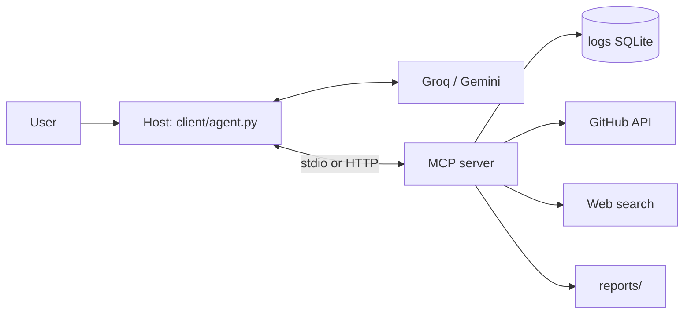

# Incident Detective — Summary

## What it is

Incident Detective is a developer tool: an AI on-call engineer. You describe a
symptom ("checkout is failing for some users"); it queries the error logs, finds
the first-seen time, looks for commits and GitHub issues around that moment, and
writes a diagnosis that names the likely cause and a recommended fix.

It is built end to end on MCP: `server/` exposes the tools and data, and
`client/` is a user-written host that connects that server to an LLM (Groq or
Gemini) in an agent loop.

## What was built (MVP)

- **MCP server** (`server/`): five tools — `logs_query_errors`,
  `github_search_issues`, `github_list_recent_commits`, `web_search_fix`, and
  `report_save_diagnosis` — plus the `db://schema` resource and an
  `investigate_incident` prompt. It runs over stdio or Streamable HTTP, and in
  HTTP mode requires a bearer token and enforces per-tool scopes.
- **MCP client + host** (`client/`): connects over stdio or Streamable HTTP,
  calls `list_tools`, converts MCP schemas into the LLM's function format,
  executes the model's tool calls, feeds results back, and stops on a final
  answer (10-step cap). Retries transient provider errors and reports quota
  exhaustion cleanly.
- **Demo data and scenario**: `data/seed.py` builds a deterministic SQLite log DB
  with a 6-hour-old `PaymentTimeoutError` spike. `test_repo/` (GitHub) contains a
  planted culprit commit ("Reduce payment client timeout from 30s to 3s") and
  three related issues.
- **Safety and access**: read-only SQLite, parameterized SQL, argument validation
  and bounds, tool errors returned as results, secret redaction on every result,
  path-traversal-safe report writing, and scoped bearer tokens for HTTP.
- **Verification**: the server was exercised through the MCP Inspector and over
  HTTP (`docs/screenshots/`), 19 unit tests cover validation/redaction/stdout
  safety/auth, and end-to-end runs over both transports produced correct reports
  (`docs/sample_report.md`).

## Architecture in one line

## Challenges and decisions

- **MCP SDK v2 surface.** The plan assumed `FastMCP`/`mcp.run()`; the installed
  SDK (2.3) uses `MCPServer`, `add_tool`, `Client`, and `StdioServerParameters`.
  I mapped the design onto the real API and pinned versions in
  `requirements.txt`.
- **Provider changes.** xAI had no credits, so the adapter moved to Gemini; when
  Gemini's free tier (20 requests/day) proved too small, it moved to **Groq**
  (~1,000 requests/day). All provider-specific code is isolated in
  `client/llm.py`; Groq's `llama-3.3-70b-versatile` was retired mid-build, so the
  default is now `openai/gpt-oss-120b`.
- **Quota and encoding.** The client backs off on transient 429/5xx, raises a
  distinct `QuotaExceeded` with a clear message on daily exhaustion, and forces
  UTF-8 output because gpt-oss emits characters the Windows console cannot encode.
- **HTTP auth.** Static bearer tokens are compared with `hmac.compare_digest`;
  per-tool scopes are enforced through the SDK's request context, so a read-only
  token gets an actionable permission error result rather than running the tool.
- **Demo realism.** Log timestamps are relative to "now", so seeding and the
  GitHub commit date must be refreshed before a demo; `docs/PLANT.md` records
  how to rebuild it.
- **stdout is sacred.** The server must never print to stdout (it is the JSON-RPC
  channel); a test enforces that.

## What I would do next

- Replace static tokens with OAuth 2.1 (the SDK's OAuth hooks are the path).
- Add pagination and richer GitHub queries (PRs, deploys, blame).
- Cache log aggregates and add a time-range filter in the UI.
- Use a paid Gemini tier or a local model for repeated demos.
- Package the host with a small config file so non-developers can run it.
