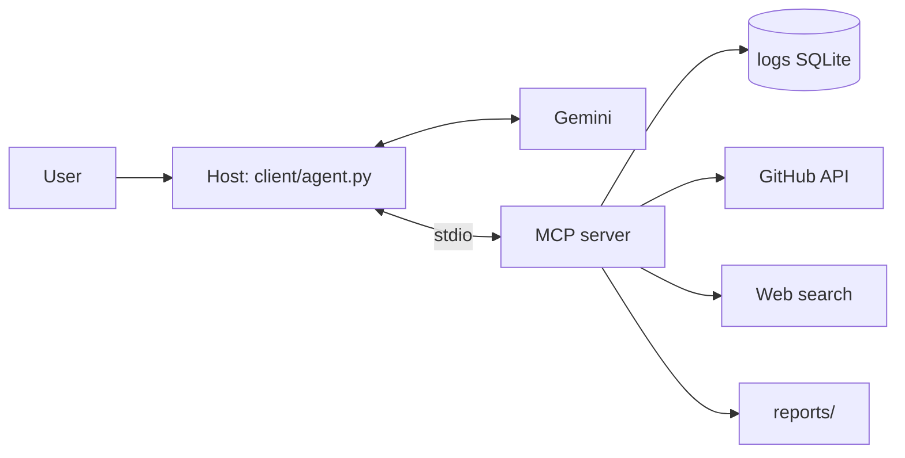

# Incident Detective — Summary

## What it is

Incident Detective is a developer tool: an AI on-call engineer. You describe a
symptom ("checkout is failing for some users"); it queries the error logs, finds
the first-seen time, looks for commits and GitHub issues around that moment, and
writes a diagnosis that names the likely cause and a recommended fix.

It is built end to end on MCP: `server/` exposes the tools and data, and
`client/` is a user-written host that connects that server to Google Gemini in an
agent loop.

## What was built (MVP)

- **MCP server** (`server/`): five tools — `logs_query_errors`,
  `github_search_issues`, `github_list_recent_commits`, `web_search_fix`, and
  `report_save_diagnosis` — plus the `db://schema` resource and an
  `investigate_incident` prompt. It runs over stdio (and exposes
  `--transport http` for later).
- **MCP client + host** (`client/`): connects over stdio, calls `list_tools`,
  converts MCP schemas into the LLM's function format, executes the model's tool
  calls, feeds results back, and stops on a final answer (10-step cap). Retries
  transient provider errors and reports quota exhaustion cleanly.
- **Demo data and scenario**: `data/seed.py` builds a deterministic SQLite log DB
  with a 6-hour-old `PaymentTimeoutError` spike. `test_repo/` (GitHub) contains a
  planted culprit commit ("Reduce payment client timeout from 30s to 3s") and
  three related issues.
- **Safety**: read-only SQLite, parameterized SQL, argument validation and
  bounds, tool errors returned as results, secret redaction on every result, and
  path-traversal-safe report writing.
- **Verification**: the server was exercised through the MCP Inspector
  (`docs/screenshots/`), 12 unit tests cover validation/redaction/stdout safety,
  and the end-to-end run produced a correct report (`docs/sample_report.md`).

## Architecture in one line

## Challenges and decisions

- **MCP SDK v2 surface.** The plan assumed `FastMCP`/`mcp.run()`; the installed
  SDK (2.3) uses `MCPServer`, `add_tool`, `Client`, and `StdioServerParameters`.
  I mapped the design onto the real API and pinned versions in
  `requirements.txt`.
- **Provider change.** xAI had no credits, so the LLM adapter was written against
  Gemini's OpenAI-compatible endpoint. All provider-specific code is isolated in
  `client/llm.py`.
- **Free-tier quota.** Gemini 2.5 Flash allows only 20 requests/day/model; one
  investigation uses ~5–6. I added backoff for transient 429s, a distinct
  `QuotaExceeded` error with a clear message, and documented the limit.
- **Demo realism.** Log timestamps are relative to "now", so seeding and the
  GitHub commit date must be refreshed before a demo; `docs/PLANT.md` records
  how to rebuild it.
- **stdout is sacred.** The server must never print to stdout (it is the JSON-RPC
  channel); a test enforces that.

## What I would do next

- Implement the HTTP transport's bearer-token scopes and OAuth 2.1.
- Add pagination and richer GitHub queries (PRs, deploys, blame).
- Cache log aggregates and add a time-range filter in the UI.
- Use a paid Gemini tier or a local model for repeated demos.
- Package the host with a small config file so non-developers can run it.
